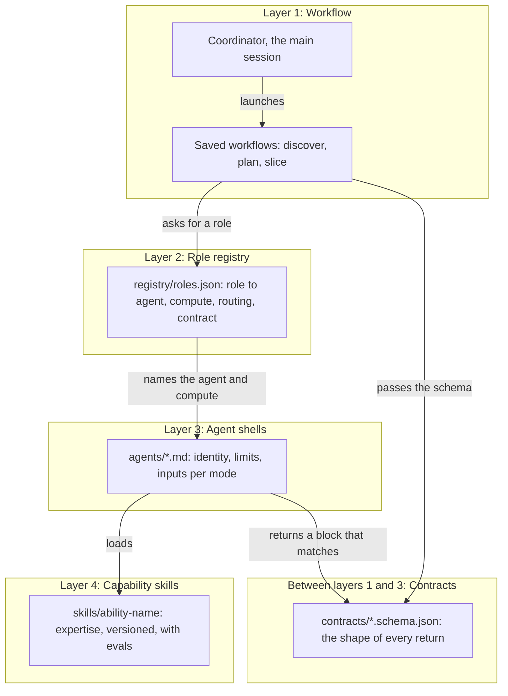
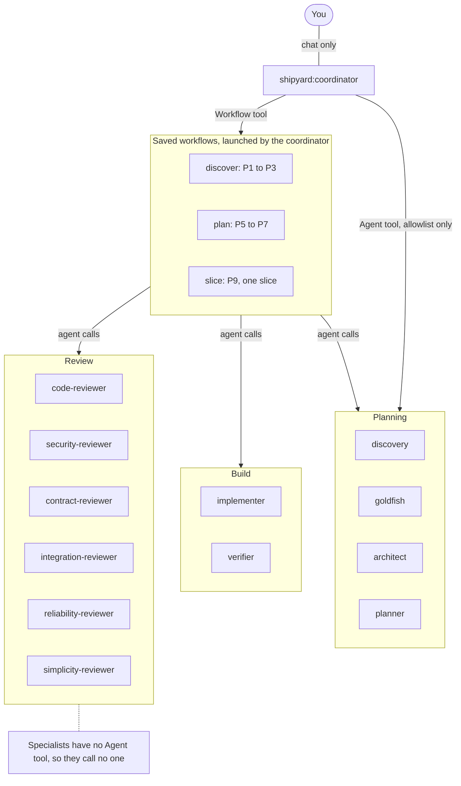

# Architecture

Shipyard has one entry point, the coordinator. It runs three saved workflows and calls twelve specialist agents.
Order, caps and routing are code. Expertise is in versioned skills. Hooks enforce the hard rules.

## The four layers

Each layer knows as little as possible about the layer below it.

Source: [02-four-layers.mmd](diagrams/02-four-layers.mmd) · rendered: [02-four-layers.svg](diagrams/02-four-layers.svg)

| Layer | Files | Knows about | Changes when |
|---|---|---|---|
| 1. Workflow | `workflows/*.js` and `agents/coordinator.md` | Roles, phases, gates, caps | The process changes |
| 2. Role registry | `registry/roles.json` | Which agent fills each role, compute per mode, routing triggers, contract names | You add a role or move compute |
| 3. Agent shells | `agents/*.md` | Identity, what the agent may touch, inputs per mode, which contract it returns | Rarely. They are short and stable |
| 4. Capability skills | `skills/<ability>/` | How to do the job well | Often. Each has a version, a changelog and evals |

**Contracts** (`contracts/*.schema.json`) sit between layers 1 and 3. The coordinator reads the contract files
and passes them to each workflow as `args.contracts`, along with the registry as `args.registry`. The workflow
hands the right schema to each agent call. Workflows never keep their own copies of a schema or an agent name.

## Hub and spoke

The coordinator is the hub. Only it talks to you. Only it, and the workflows it launches, call specialists.

Source: [03-hub-and-spoke.mmd](diagrams/03-hub-and-spoke.mmd) · rendered: [03-hub-and-spoke.svg](diagrams/03-hub-and-spoke.svg)

| Who | May call | How |
|---|---|---|
| You | The coordinator | Chat |
| Coordinator | The three saved workflows | Workflow tool: `shipyard:discover`, `shipyard:plan`, `shipyard:slice` |
| Coordinator | The twelve specialists, directly | Agent tool, limited by an allowlist. Used for work no workflow covers: P10 reconcile, conformance checks, adjudication |
| Saved workflows | Specialists | `agent()` calls inside the script |
| Specialists | No one | They have no Agent tool |

The specialists, grouped:

| Group | Agents |
|---|---|
| Planning | `discovery`, `goldfish`, `architect`, `planner` |
| Build | `implementer` (code only), `verifier` (test plan, tests and evidence) |
| Review | `code-reviewer`, `security-reviewer`, `contract-reviewer`, `integration-reviewer`, `reliability-reviewer`, `simplicity-reviewer` |

One page per agent is generated in [agents/](agents/).

### The three saved workflows

| Workflow | Phases | Returns |
|---|---|---|
| `/shipyard:discover` | P1 Scan, P2 Brainstorm and narrow, P3 Draft | Repo facts, top concepts, disagreements, gap list |
| `/shipyard:plan` | P5 Critique, P6 Refine, P7 Delivery planning | Critiqued plan, slices with touch sets, readiness results, or new questions for you |
| `/shipyard:slice` | P9 for one slice | `READY_FOR_HUMAN`, `ESCALATE`, `NEEDS_SHARED_APPROVAL`, `BLOCKED_REVIEWER` or `BLOCKED`, plus evidence and findings |

There are three workflows, not one, because a workflow cannot pause to ask you something. Each workflow runs the
stretch between two human stops. See [ADR-0001](decisions/ADR-0001-saved-workflows.md).

## Claude Code features used

| Feature | How Shipyard uses it |
|---|---|
| Main-session agent | `claude --agent shipyard:coordinator` makes the coordinator the session itself, so it can talk to you and hold the gates. |
| Subagents without the Agent tool | Specialists leave `Agent` out of their `tools`, so they cannot start other agents. |
| `Agent(...)` allowlist | The coordinator's `tools` line lists exactly the twelve `shipyard:` specialists it may call. |
| Frontmatter `model` and `effort` | Each agent file sets its default compute class. Workflows override per mode from the registry. |
| Skills preloading | Each agent's `skills:` list preloads the shared `shipyard-framework` skill and its capability skills. |
| Plugin hooks | `hooks/hooks.json` runs eight Python hooks. They branch on `agent_type` and do nothing outside Shipyard. See [guardrails.md](guardrails.md). |
| Saved workflows | `workflows/discover.js`, `plan.js`, `slice.js` run as `/shipyard:<name>`. They fix order, caps, routing and dedupe in code. |
| Schema-checked returns | Workflows pass a JSON Schema to each `agent()` call. The runtime checks the return. Direct calls end with one fenced JSON block that `scripts/shipyard_validate.py` checks. |

Hooks placed in a plugin agent's frontmatter are ignored by Claude Code. That is why all Shipyard hooks live in
`hooks/hooks.json`.

## Compute classes

| Class | Model | Effort | Used for |
|---|---|---|---|
| `COORDINATOR` | opus | max | The coordinator session. Set at launch: `--model opus --effort max`. |
| `DEEP` | opus | high | Judgment: synthesis, questions, goldfish, architect, planner, test plans, all reviewers |
| `STANDARD` | sonnet | medium | Doing: repo scan, drafting, implementing, writing tests, running verification |

Per role and mode:

| Role | Modes and class |
|---|---|
| coordinator | `COORDINATOR` |
| discovery | SCAN and DRAFT `STANDARD`; SYNTHESIZE and QUESTIONS `DEEP` |
| goldfish | `DEEP` |
| architect | `DEEP` in all modes |
| planner | `DEEP` |
| implementer | `STANDARD` |
| verifier | TEST_PLAN `DEEP`; WRITE_TESTS, VERIFY and FIX_TESTS `STANDARD` |
| all six reviewers | `DEEP` |

A delegate never gets more compute than the coordinator's own session. To change a class, edit the registry.
See [extending.md](extending.md#change-compute-for-a-role).

## State and helpers

- `.ai/state.json` holds the machine state. Only the coordinator writes it, through
  `scripts/shipyard_state.py`, so it always matches `contracts/state.schema.json`. Hooks read it.
- `scripts/shipyard_validate.py <contract-stem> <file|->` checks a return block against a contract. The
  coordinator uses it for direct calls outside workflows.
