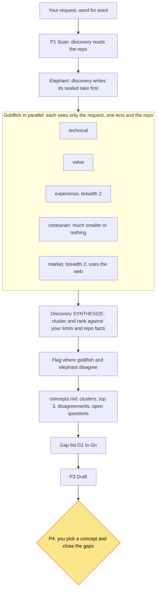

# Brainstorm: elephant and goldfish

Before planning, Shipyard explores the idea from several angles. It uses the elephant/goldfish method from
[vshvedov/elephant-goldfish](https://github.com/vshvedov/elephant-goldfish) (MIT licence), adapted for this
workflow.

- The **elephant** remembers everything. Here that is the discovery agent, which has scanned your repo.
- A **goldfish** remembers nothing. Each one starts fresh with only your request, one lens and read access to
  the repo. It never sees the scan notes or the elephant's view.

Fresh eyes catch what deep context hides. Independent takes stop one framing from shaping every idea.

## How it runs (P2)

Source: [09-elephant-goldfish.mmd](diagrams/09-elephant-goldfish.mmd) · rendered: [09-elephant-goldfish.svg](diagrams/09-elephant-goldfish.svg)

1. **Sealed take.** Discovery writes its own view to `.ai/planning/concepts.md` first. This stops it from
   adjusting its view after seeing the goldfish.
2. **Parallel lenses.** The goldfish run in parallel, one per lens.
3. **Converge.** Discovery (in SYNTHESIZE mode, deep compute) clusters and ranks the ideas against your C-1 to
   C-9 limits and the repo facts. It flags every place where goldfish and elephant disagree. Disagreement is
   recorded, never averaged away.
4. **Gap list.** Discovery writes the concepts brief (clusters, top 3, disagreements, open questions) and a gap
   list `G1` to `Gn`.
5. **Your pick at P4.** The coordinator shows you the top concepts and only the gaps that change the plan. You
   pick.

## Lenses and breadth

You choose the breadth at intake.

| Breadth | Lenses | Good for |
|---|---|---|
| 0 | None. The brainstorm is skipped. | Work whose shape is already decided. Lowest cost. |
| 1 | technical, value, contrarian | Most projects |
| 2 | technical, value, experience, contrarian, market, plus a contrarian "outsider" sweep | Big or uncertain bets |

| Lens | Question it asks |
|---|---|
| technical | What is the soundest way to build this here? |
| value | What gives the most value for the least change? |
| experience | What do consumers and operators actually go through? |
| contrarian | Could this be much smaller, or not done at all? |
| market | How do others solve this? Uses web search. Breadth 2 only. |

## Readiness checks (P7)

The goldfish come back once more at the end of planning. One goldfish reads each `SLICE.md` cold, with no other
context. It answers one question: could a first-time implementer ship this without asking anything?

It returns `READY`, or `NOT_READY` with the questions it would have asked. A `NOT_READY` slice is fixed, or its
questions are raised with you, before the plan reaches you at P8.
