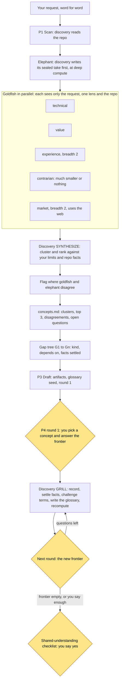

# Brainstorm: elephant and goldfish

Before planning, Shipyard explores the idea from several angles. It uses the elephant/goldfish method from
[vshvedov/elephant-goldfish](https://github.com/vshvedov/elephant-goldfish) (MIT licence), adapted for this
workflow.

- The **elephant** remembers everything. Here that is the discovery agent, which has scanned your repo.
- A **goldfish** remembers nothing. Each one starts fresh with only your request, one lens and read access to
  the repo. It never sees the scan notes or the elephant's view.

Fresh eyes catch what deep context hides. Independent takes stop one framing from shaping every idea.

## How it runs (P2)

Source: [09-elephant-goldfish.mmd](diagrams/09-elephant-goldfish.mmd) · rendered: [09-elephant-goldfish.svg](diagrams/09-elephant-goldfish.svg)

1. **Sealed take.** Discovery writes its own view to `.ai/planning/concepts.md` first, in a separate call at
   deep compute. This stops it from adjusting its view after seeing the goldfish, and makes sure the elephant's
   half of the disagreement is as strong as the goldfish's.
2. **Parallel lenses.** The goldfish run in parallel, one per lens.
3. **Converge.** Discovery (in SYNTHESIZE mode, deep compute) clusters and ranks the ideas against your C-1 to
   C-9 limits and the repo facts. It flags every place where goldfish and elephant disagree. Disagreement is
   recorded, never averaged away.
4. **Gap tree.** Discovery writes the concepts brief (clusters, top 3, disagreements, open questions) and a gap
   tree `G1` to `Gn`: each gap has a kind (concept, scope, term, decision, invariant or fact) and the gaps it depends
   on. Questions the goldfish raised become leaves. Facts are settled from the repo and never asked.
5. **Your pick at P4.** The coordinator shows you the top concepts and round 1 of the grill. You pick, and the
   grill begins.

## Lenses and breadth

You choose the breadth at intake.

| Breadth | Lenses | Good for |
|---|---|---|
| 0 | None. The brainstorm is skipped. | Work whose shape is already decided. Lowest cost. |
| 1 | technical, value, contrarian | Most projects |
| 2 | technical, value, experience, contrarian, market, plus a contrarian "outsider" sweep | Big or uncertain bets |

| Lens | Question it asks |
|---|---|
| technical | What is the soundest way to build this here? |
| value | What gives the most value for the least change? |
| experience | What do consumers and operators actually go through? |
| contrarian | Could this be much smaller, or not done at all? |
| market | How do others solve this? Uses web search. Breadth 2 only. |

## The grill (P4)

The brainstorm finds the ideas you could not see. The grill finds the details only you know. It is adapted from an
MIT-licensed grilling method (see [NOTICE](../NOTICE)) and works as rounds:

1. **Round 1** is the concept pick plus the **frontier**: every question whose prerequisites are already settled,
   highest leverage first, at most 7. Each has evidence from the repo, why it matters, options and a recommendation
   worded so a plain "yes" accepts it.
2. **Between rounds** discovery records your answers word for word, settles any new fact from the repo (you are
   never asked something the code can answer), challenges a term you used that the glossary or the code uses
   differently, adds the questions your answers opened, and writes `.ai/GLOSSARY.md` right then. An answer that is
   hard to reverse, surprising without context and a real trade-off becomes a short ADR in `.ai/decisions/`.
3. **It ends** when nothing is left to ask, when you say "enough" or "go with your recommendations" (open questions
   take their recommended default, marked as assumed), or after 3 rounds. You can always ask for more rounds. The
   coordinator then shows a short checklist (concept, terms settled, decisions recorded, defaults taken) and waits
   for your yes.

There is no cap on the total number of questions. Some plans need three, some need forty. The caps are on how many
are asked at once and on rounds, so your attention is spent in short, well-ordered bursts. If the first round seems
small, that is the tree working: the next questions depend on these answers.

## Readiness checks (P7)

The goldfish come back once more at the end of planning. One goldfish reads each `SLICE.md` cold, with no other
context. It answers one question: could a first-time implementer ship this without asking anything?

It checks the acceptance criteria are testable, the touch sets and branch are stated, the seams the tests will
observe exist, and the commands run. It returns `READY`, or `NOT_READY` with the questions it would have asked. A
`NOT_READY` slice is fixed, or its questions are raised with you, before the plan reaches you at P8.
