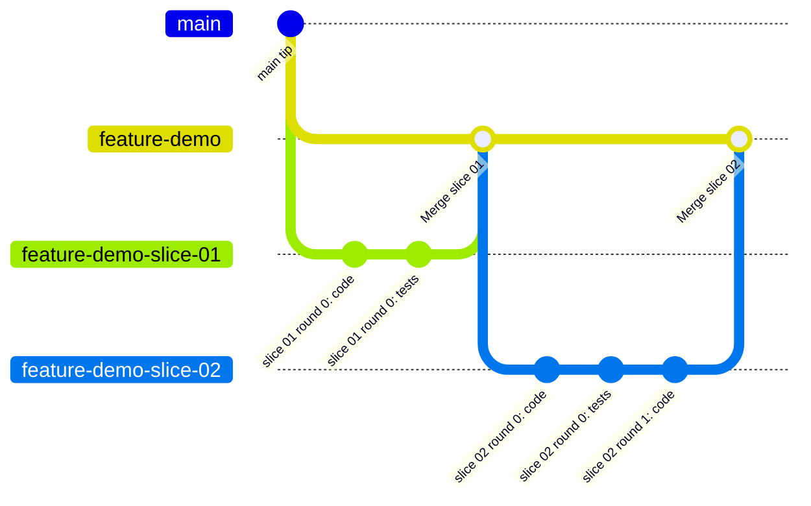

# Branching and merging

Shipyard works on branches you can throw away. It merges locally, into a feature branch you name. It never
touches `main` and never pushes.

## The branch model



<sub>Source: [08-branching.mmd](diagrams/08-branching.mmd) · rendered: [08-branching.svg](diagrams/08-branching.svg)</sub>

Real branch names use `/`, for example `feature/demo` and `feature/demo-slice-01`. The diagram uses `-` instead
because some Mermaid renderers do not accept `/` in gitGraph branch names.

| Branch | Created by | Created from | Holds |
|---|---|---|---|
| Base branch, usually `main` | You | — | Untouched by Shipyard |
| Feature branch, for example `feature/demo` | Coordinator at P0, if missing | The base branch | Only `--no-ff` merges of approved slices |
| Slice branch, for example `feature/demo-slice-01` | Coordinator at P9 | The tip of the feature branch | The slice's code, tests and `.ai/` commits |

## The rules

1. **Never push.** No `git push` of any kind, by any Shipyard agent.
2. **Protected branches are off limits.** No merge, commit, rebase, reset or cherry-pick while on `main`,
   `master`, the repo's default branch, or any branch in `state.json` → `protectedBranches`.
3. **The feature branch must not be protected.** At P0 the coordinator refuses `main`, `master`, the default
   branch and protected patterns, and checks the name with `git check-ref-format --branch`.
4. **Each agent commits only its own work.**

| Who | Commits | Message |
|---|---|---|
| Implementer | Its code paths, at the end of each build or fix step | `slice <id> round <n>: code` |
| Verifier | Its test paths, at the start of VERIFY | `slice <id> round <n>: tests` |
| Coordinator | The merge into the feature branch, and nothing else | `Merge slice <id>: <title>`, plus a short evidence summary |

`.ai/` never lands on a work branch. Git ignores it there through `.git/info/exclude` (git's per-machine ignore
list), so your project's `.gitignore` is not changed and your pull request holds only code and tests. Instead the
coordinator commits `.ai/` to the **notes branch** `<feature>-shipyard` at every checkpoint, with
`shipyard_state.py snapshot`. That uses git plumbing: it never checks the notes branch out and never touches your
working tree, index or current branch. The notes branch holds only `.ai/`, is never merged, and is yours to push if
you want a copy. In a fresh clone, `shipyard_state.py restore --from <notes branch>` brings `.ai/` back. A hook
refuses any `git add` of `.ai/`, any coordinator commit, and any checkout, merge, move or delete of the notes
branch.

Reviewers, the architect, the planner, discovery and the goldfish never change git state. A hook enforces this.

## The merge procedure

The coordinator merges only after you approve the slice's brief in chat. It then:

1. Checks the working tree is clean.
2. Checks out the feature branch.
3. Confirms the slice branch tip is the evidence commit recorded in `EVIDENCE.md`. If code or tests changed after
   review, the evidence is stale and the merge stops.
4. Runs `git merge --no-ff <slice-branch> -m "Merge slice <id>: <title>" -m "<evidence summary>"`. The summary
   (ACs verified, test result, reviewers, rounds, accepted risks) explains the merge in the feature branch's own
   history.
5. Re-runs the canonical test command on the feature branch.
6. Sets the slice to `MERGED` only after all of that succeeds.

The slice branch is kept, so you can inspect it later.

`--no-ff` keeps one merge commit per slice. The feature branch history then reads as a list of reviewed slices.

## Conflicts

Slices are cut from the feature branch tip and merged in order, so conflicts are rare. If one happens, the
coordinator runs `git merge --abort`, reports in one line, and stops. Nothing is half-merged. You decide what
happens next: usually the coordinator re-cuts the slice from the new feature branch tip, or you resolve the
conflict yourself.

## Your final step

When the project is `COMPLETE`:

```bash
git push -u origin feature/demo
```

Then raise a pull request from `feature/demo` to `main`. Reviewers can read the PR slice by slice, using the merge
commits and each slice's `EVIDENCE.md`.
