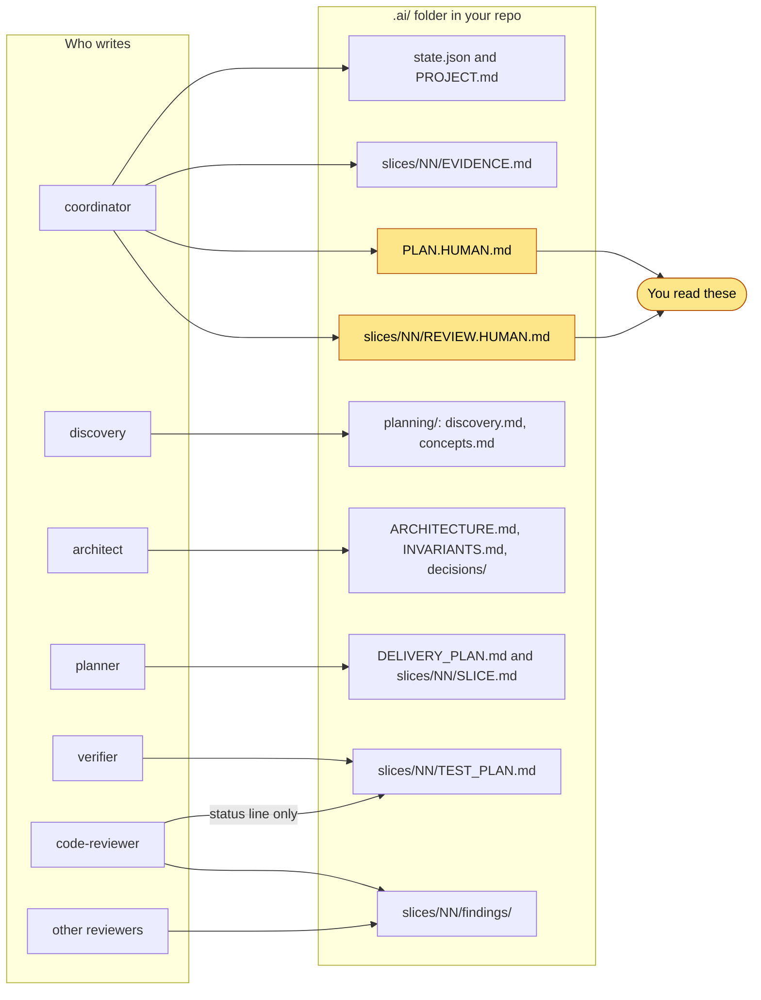

# Concepts

This page explains the words Shipyard uses. Read it once before your first project.

## Slices

A **slice** is a small piece of the job that can be merged on its own. It has a goal, acceptance criteria (ACs),
and two touch sets: the code paths it may change and the test paths it may change. It lives on its own branch,
cut from the feature branch.

A good slice is vertical. It delivers a working, testable step, not a layer. "Add the LRU cache and move the
two read paths to it" is a slice. "Write all the interfaces first" is not.

Slices move through fixed states: `PROPOSED → APPROVED → TEST_PLANNING → IMPLEMENTING → VERIFYING →
AGENT_REVIEW → READY_FOR_HUMAN → HUMAN_REVIEW → MERGED`. `MERGED` is the only end state. See
[slice-loop.md](slice-loop.md).

## Gates

A **gate** is a point where work stops until a condition is met.

| Gate | Who clears it | Condition |
|---|---|---|
| P0 Intake | You | You answered the intake question (or accepted defaults) |
| P4 Questions | You | You picked a concept and answered the gaps that change the plan |
| P8 Plan approval | You | You approved `PLAN.HUMAN.md` explicitly |
| Test plan | The code-reviewer agent | `TEST_PLAN.md` says `Status: APPROVED` |
| Merge (P9.9) | You | You approved `REVIEW.HUMAN.md` explicitly |

Agents recommend. They never approve on your behalf. Silence or general enthusiasm is not approval.

## Evidence

**Evidence** is something you can open and check: a command and its output, a line of code, a contract, a
decision record. Every finding must carry evidence. Every slice ends with `EVIDENCE.md`, which records the test
command, its result, the scope check, which reviewers ran and why, and the commit the evidence belongs to.

Shipyard prefers checking to guessing. If a claim can be settled by a command that runs in under 60 seconds, an
agent runs it.

## Assumption labels

Every important fact gets a label.

| Label | Meaning |
|---|---|
| `SPECIFIED` | You said it, or an approved document says it. |
| `DERIVED` | It follows from specified facts, or from evidence actually seen, such as command output. |
| `ASSUMED` | Reasonable but not proven. It carries a note on the risk if it is wrong. |
| `UNRESOLVED` | Needs more evidence or a human decision. A claim that could have been checked but was not is `UNRESOLVED`. |

`ASSUMED` and `UNRESOLVED` facts that would make the work unsafe must be closed before the plan gate at P8.

## Findings

A **finding** is one problem a reviewer found. Each finding has the same fields:

| Field | Meaning |
|---|---|
| ID | For example `code-007` |
| Severity | `BLOCKING`, `MAJOR`, `MINOR` or `NOTE` |
| Category | The kind of problem, for example clarity or concurrency |
| Location | `path:line-range`, `whole slice`, or a planning file |
| Finding | What is wrong, stated as a fact |
| Why it matters | The consequence |
| Evidence | Mandatory. Something a human can open |
| Required resolution | The smallest change that clears it |
| Confidence | `HIGH`, `MEDIUM` or `LOW` |
| Reporter(s) | Which reviewers reported it |
| Owner | Who must act: usually the implementer (code) or the verifier (tests) |
| Status | `OPEN`, `FIXED`, `REBUTTED` or `ACCEPTED_BY_HUMAN` |

### Severities and fix scope

| Severity | Meaning | Must be closed before you see the slice? |
|---|---|---|
| `BLOCKING` | Wrong, unsafe or breaks a contract | Yes |
| `MAJOR` | A real problem that will cost later | Yes |
| `MINOR` | A small but real problem | Yes |
| `NOTE` | A suggestion | No, optional |

"Closed" means fixed, or formally rebutted. A rebuttal cites evidence. The reviewer who raised the finding then
answers `ACCEPT_REBUTTAL` or `MAINTAIN_FINDING`. Each finding gets one rebuttal.

Security findings use their own scale and map onto this one: critical and high become `BLOCKING`, medium becomes
`MAJOR`, low becomes `MINOR`, informational becomes `NOTE`.

## Roles, agents, abilities and contracts

Four words that are easy to mix up:

| Word | What it is | Where it lives | Example |
|---|---|---|---|
| Role | A job in the process. Workflows only know roles. | `registry/roles.json` | `code-review` |
| Agent | The Claude Code subagent that fills a role. A short shell: identity, limits, inputs, return. | `agents/*.md` | `shipyard:code-reviewer` |
| Ability | The expertise an agent loads. A versioned skill with its own changelog and evals. | `skills/<ability>/` | `code-clarity`, `test-quality` |
| Contract | The JSON Schema for what an agent returns. Versioned. | `contracts/*.schema.json` | `reviewer-result` 1.0.0 |

This split means you can improve an ability without touching the workflow, as long as the agent still returns
a valid contract. See [architecture.md](architecture.md) and [ADR-0004](decisions/ADR-0004-roles-not-agent-names.md).

## The `.ai/` folder

Shipyard keeps all project state in `.ai/` at the root of your repo. It is plain text and JSON, so a run can resume
from disk alone. It **never enters your work branches**: at intake the coordinator adds `/.ai/` to
`.git/info/exclude`, git's per-machine ignore list, so the feature branch, the slice branches and your pull request
hold only code and tests, and your project's `.gitignore` is not touched. Instead, at every checkpoint the
coordinator commits `.ai/` to a separate **notes branch** (`<feature>-shipyard`) without checking it out. The full
history of the notes is in git, and a fresh clone can restore `.ai/` from that branch and resume. Push the notes
branch yourself if you want a copy off your machine.

You read only two kinds of thing: what the coordinator shows in chat, and files ending in `.HUMAN.md`. Each
`.HUMAN.md` file fits on one screen. Everything else is for agents.

Source: [10-ai-map.mmd](diagrams/10-ai-map.mmd) · rendered: [10-ai-map.svg](diagrams/10-ai-map.svg)

| Path | Written by | Purpose |
|---|---|---|
| `state.json` | coordinator only | Machine state for hooks and resume: status, branches, active slice |
| `PROJECT.md` | coordinator | Problem, goals, scope, your C-1 to C-9 answers, status, phase log |
| `planning/` | discovery (plus reviewers' plan findings) | Repo facts, brainstorm concepts, assumptions, open questions |
| `ARCHITECTURE.md`, `INVARIANTS.md`, `decisions/` | architect | Current and target design; properties every slice must keep |
| `DELIVERY_PLAN.md`, `slices/NN/SLICE.md` | planner | Slices, order, touch sets, branches |
| `slices/NN/TEST_PLAN.md` | verifier (code-reviewer flips the status line) | AC to test map; gated by code review |
| `slices/NN/findings/` | each reviewer, one file each | Raw findings |
| `slices/NN/EVIDENCE.md` | coordinator | Verification and review record |
| `PLAN.HUMAN.md` | coordinator | Your plan-approval brief |
| `slices/NN/REVIEW.HUMAN.md` | coordinator | Your merge brief |

`EVIDENCE.md` keeps the summary of the findings, and each merge commit message carries a short evidence summary, so a
record of every slice survives in git. No secrets ever go into `.ai/`. A hook blocks writes that look like secrets.
