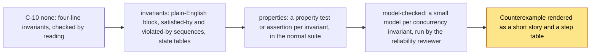

# Formal rigour: readable invariants, property tests and model checking

Shipyard can make the rules your system must never break explicit, executable and, where it matters most,
model-checked. It is opt-in. You choose a tier at intake (parameter C-10) and every tier is written so that an
engineer who has never seen a formal specification can read the result.



<sub>Source: [11-formal-tiers.mmd](diagrams/11-formal-tiers.mmd) · rendered: [11-formal-tiers.svg](diagrams/11-formal-tiers.svg)</sub>

## The tiers

| C-10 | You get | Cost | Choose it when |
|---|---|---|---|
| `none` (default) | `INVARIANTS.md` with a statement, rationale and a way to verify each rule | Nothing extra | Ordinary features; no money, concurrency, retries or tenants involved |
| `invariants` | Every rule in plain English with why it matters, one sequence that keeps it, one that breaks it, and a state-by-event table and diagram for anything stateful | A little more architect time; no tools | The request mentions concurrency, retries, money, deadlines or multi-tenancy |
| `properties` | A property-based test or a runtime assertion per rule, planned in the test plan and run with the suite | One test library the repo already has | You want the rules to stay true as the code changes |
| `model-checked` | A small model per concurrency or failure rule, checked by a model checker within a bound, with any counterexample told as a story | The `quint` tool (and Java) on your machine; some reviewer time | The core of the work is interleaving, crashes mid-operation, or exactly-once effects |

Each tier includes the ones below it. The human-facing rule: **you approve properties, not models.** At plan
approval you see at most five lines under "Properties you are relying on": the rule, what it means, how it is
checked, and its status.

## What an invariant looks like at `invariants` and above

```markdown
### INV-003: A job's side effect is applied at most once, even across worker crashes
Statement:        For every job j, count(side_effect_applied(j)) <= 1 in every reachable state.
Rationale:        At-least-once delivery plus a non-idempotent effect double-charges.
How to verify:    property test on the queue; model at .ai/formal/INV-003.qnt
Introduced by:    ADR-001
Plain English:    A job may be attempted many times, but the thing it does (charge, email, write) happens at most
                  once, no matter when a worker dies.
Why it matters:   Prevents double charges and duplicate emails after a crash between "did the work" and "marked
                  it done".
Satisfied by:     lease -> execute(key=j.id) -> ack -> DONE. Worker crashes after ack: nothing re-runs.
Violated by:      lease -> execute -> crash before ack -> re-lease -> execute again. Two charges.
Check:            tier 0: table below · tier 1: tests/jobs/test_once.py :: idempotent_under_crash
                  · tier 2: .ai/formal/INV-003.qnt, invariant executeAtMostOnce
Status:           tier 1 PASS (slice 02) · tier 2 VIOLATED (trace below) -> redesigned, see ADR-003
Tags:             concurrency, partial-failure
```

| State | Event | Next state | Side effect | Allowed? |
|---|---|---|---|---|
| PENDING | lease | LEASED | none | yes |
| LEASED | execute | LEASED (ack in flight) | apply(j) | yes, once |
| LEASED | ack | DONE | none | yes |
| LEASED | worker crash | PENDING | none | yes, but see INV-003 |
| DONE | lease | – | – | forbidden |

## What a counterexample looks like

The reliability reviewer runs the model and writes the result for you, not for a logician:

> **INV-003 is violated in 5 steps.** A worker leases the job, applies the side effect, and dies before it can
> acknowledge. The lease expires, the job returns to PENDING, a second worker leases it and applies the side effect
> again.

| Step | Action | status | applied | ackPending |
|---|---|---|---|---|
| 0 | init | Pending | 0 | no |
| 1 | lease | **Leased** | 0 | no |
| 2 | execute | Leased | **1** | **yes** |
| 3 | crash | **Pending** | 1 | **no** |
| 4 | lease | **Leased** | 1 | no |
| 5 | execute | Leased | **2** | **yes** |

> **What this means:** as designed, "at most once" cannot hold: no ordering of "apply" and "ack" survives a crash
> between them. **Minimum correction:** make `execute` idempotent on the job id and restate INV-003 as "at most
> once per idempotency key".

That is the usual real-world outcome: the check rarely finds a code bug; it shows that a rule as stated cannot be
kept, before any slice is cut.

## Safeguards

- **A model must be able to fail.** The architect also writes a copy with a planted fault; the reviewer runs it and
  it must fail. A model that cannot fail proves nothing and is rejected.
- **A property must fail against a do-nothing implementation.** The test plan says how; the code reviewer checks.
- **Properties come from you.** An `invariant` question in the grill is how you state one in your own words. A rule
  an agent inferred is marked `ASSUMED` and can never be reported as model-checked.
- **Bounded, never proved.** A passing model check is reported as `model-checked (bounded, N steps)`.
- **No installs.** Shipyard discovers `quint` and `java` at the scan and reports `NOT_RUN` with the reason when they
  are missing. Install them yourself if you want the top tier.
- **Only where it pays.** Models are written only for rules tagged concurrency, lifecycle or partial-failure. The
  simplicity reviewer may file against a model of a plain create-read-update flow.

## Where it lives

| Artifact | Written by | Read by |
|---|---|---|
| `.ai/INVARIANTS.md` extended blocks, tables, diagrams | architect | every reviewer, the verifier, you at P8 (summary) |
| `.ai/formal/INV-nnn.qnt` and `INV-nnn.fault.qnt` | architect | reliability reviewer |
| `.ai/formal/INV-nnn.trace.itf.json` | `scripts/formal_check.py` | reliability reviewer, verifier (trace replay) |
| `TEST_PLAN.md ## Invariants exercised` | verifier | code-reviewer |
| `PLAN.HUMAN.md ## Properties you are relying on` | coordinator | you |

The role-by-role contract is in the framework skill's `references/formal-methods.md`. The decision record is
[ADR-0009](decisions/ADR-0009-formal-rigour-tiers.md).
