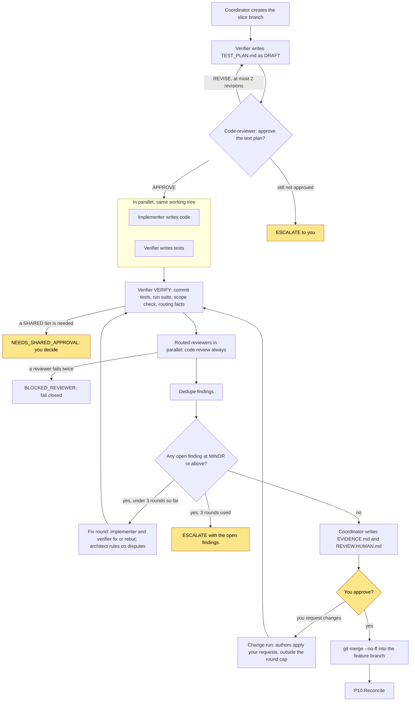
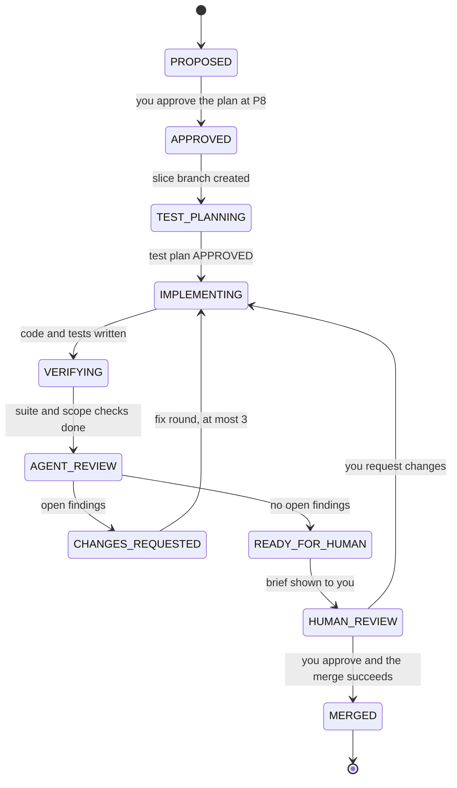
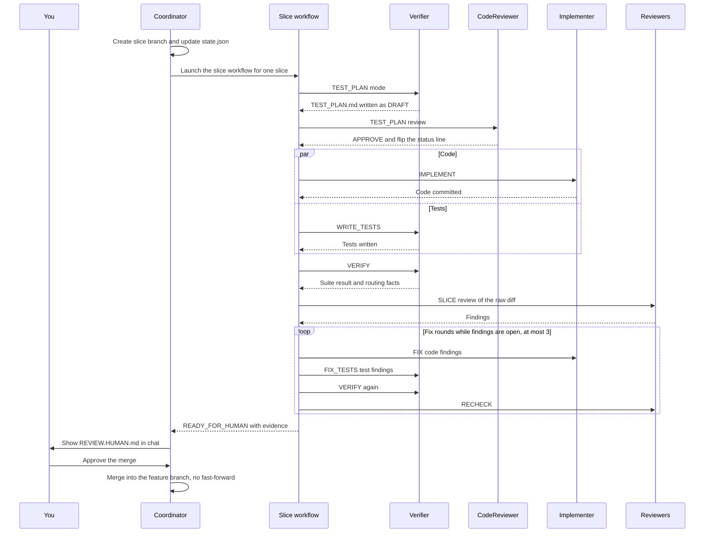

# The slice loop

Each slice runs the same loop. The coordinator sets it up. The `/shipyard:slice` workflow runs it. You approve
the result. The loop is the same for every slice, and its order and caps are fixed in code.

## The loop at a glance

Source: [05-slice-loop.mmd](diagrams/05-slice-loop.mmd) · rendered: [05-slice-loop.svg](diagrams/05-slice-loop.svg)

Step by step:

1. **Slice branch.** The coordinator creates `<feature>-slice-<id>` from the tip of the feature branch, checks it
   out, and records it in `state.json`. Then it launches the workflow.
2. **Test plan.** The verifier writes `.ai/slices/<id>/TEST_PLAN.md` with `Status: DRAFT`. It maps every
   acceptance criterion to planned tests and lists failure cases, benchmarks for performance criteria, and what
   cannot be verified here.
3. **Test-plan gate.** The code-reviewer reviews the plan. On APPROVE it changes only the status line to
   `Status: APPROVED` and reads it back; if the change did not land, the workflow stops before anything is built.
   On REVISE the verifier revises. After 2 revisions without approval, the workflow returns `ESCALATE`. Once
   approved, the plan is frozen: changing it means rewriting it as `DRAFT` and approving it again.
4. **Build, in parallel.** The implementer writes code in the code touch set. The verifier writes tests in the
   test touch set. Both work from `SLICE.md` and `TEST_PLAN.md`, never from each other's work. A hook blocks
   both until the plan is approved, whether they write with the editor tools or the shell. The implementer
   commits `slice <id> round <n>: code`. If an author says the approved design cannot be followed, or that a
   test is wrong, the architect rules on it and the ruling goes back to the right author in the same round.
5. **Verify.** The verifier confirms the test plan still says `APPROVED` (the workflow stops if not), commits
   `slice <id> round <n>: tests`, runs the full test suite, checks that every
   changed file is inside a touch set, runs the planned validation tiers, and reports routing facts. If a tier
   needs a shared environment, the workflow stops with `NEEDS_SHARED_APPROVAL`. The coordinator asks you, and
   re-launches only after an explicit yes.
6. **Routed review.** The reviewers that the facts call for run in parallel on the raw diff
   `git diff <featureBranch>...<sliceBranch>`, the raw `SLICE.md` and the raw `TEST_PLAN.md`. The code reviewer
   always runs, even for a slice that only adds tests. A finding filed with category `security` brings in the
   security reviewer if routing had not.
7. **Dedupe.** Findings from different reviewers at the same location in the same category become one finding.
   It keeps the highest severity and every reporter. Two findings from the same reviewer are never merged.
8. **Fix round.** If any finding at `MINOR` or above is open, the implementer (code findings) and the verifier
   (test findings) fix or rebut in parallel. A rebuttal goes to the reviewer that filed the finding, once. Then
   the loop goes back to step 5. In the next review, reviewers recheck their open findings, and the code reviewer
   also reviews everything changed since its last review, even if it had no findings of its own.
9. **Brief.** When nothing at `MINOR` or above is open and no author reports stubs or unmet acceptance criteria,
   the workflow returns `READY_FOR_HUMAN`. The coordinator
   writes `EVIDENCE.md` and `REVIEW.HUMAN.md`, snapshots `.ai/` to the notes branch (never the slice branch), and
   shows you the brief.
10. **Merge.** You approve. The coordinator merges with `--no-ff` into the feature branch and runs reconcile (P10).
    If you ask for changes instead, the coordinator relaunches the workflow with your requests as `humanChanges`:
    the authors apply them (they cannot rebut you), then verification and every routed review run again in full.
    Your requests do not use up the 3 fix rounds. A change that alters the acceptance criteria goes back through
    `SLICE.md` and a fresh run, starting from the test plan.

## Slice states

Source: [06-slice-states.mmd](diagrams/06-slice-states.mmd) · rendered: [06-slice-states.svg](diagrams/06-slice-states.svg)

| State | Meaning |
|---|---|
| `PROPOSED` | In the plan, not yet approved |
| `APPROVED` | You approved the plan at P8 |
| `TEST_PLANNING` | The test plan is being written and reviewed |
| `IMPLEMENTING` | Code and tests are being written, or fixed |
| `VERIFYING` | The suite, scope check and tiers are running |
| `AGENT_REVIEW` | Routed reviewers are reviewing |
| `CHANGES_REQUESTED` | Open findings; a fix round follows |
| `READY_FOR_HUMAN` | Clean; the brief is being written |
| `HUMAN_REVIEW` | You have the brief |
| `MERGED` | Merged into the feature branch. The only end state |

`HUMAN_REVIEW` is set when you are shown the brief. `MERGED` is set only after the merge succeeds.

## One slice in time order

Source: [07-slice-sequence.mmd](diagrams/07-slice-sequence.mmd) · rendered: [07-slice-sequence.svg](diagrams/07-slice-sequence.svg)

## Routing: which reviewers run

The verifier reports routing facts as true or false, each with evidence. The registry turns facts into
reviewers.

| Reviewer | Runs when |
|---|---|
| code-reviewer | Any production code changed |
| simplicity-reviewer | Production code changed, unless the slice is mechanical only (renames, version bumps, generated code, formatting, config values) |
| security-reviewer | Auth, tokens or secrets, isolation, untrusted input, crypto, a new network surface |
| contract-reviewer | Public API, wire format, DTOs, externally visible errors; or config that consumers set |
| integration-reviewer | Behaviour a consumer or operator can see; a public contract or config change |
| reliability-reviewer | Concurrency, retries, timeouts, cancellation, networking, streaming, resource lifetime |

If a fact is uncertain, the reviewer runs. Reviewers not routed are listed in `EVIDENCE.md` with the reason.

A reviewer that returns nothing or invalid output is retried once. If it fails again, the workflow returns
`BLOCKED_REVIEWER`. Shipyard never treats a missing review as a clean one.

## Fix scope, rebuttals and caps

- **Fix scope:** every `BLOCKING`, `MAJOR` and `MINOR` finding must be fixed or rebutted before you see the
  slice. `NOTE` is optional.
- **Owner:** each finding names who acts. The implementer owns code paths and code actions. The verifier owns
  test paths and tests to add, remove or reshape.
- **Rebuttal:** the owner may rebut a finding once, with a citation, instead of fixing it. The reviewer who
  raised it answers `ACCEPT_REBUTTAL` or `MAINTAIN_FINDING`. A maintained architectural `BLOCKING` finding goes
  to the architect to adjudicate. If that does not settle it, it goes to you.
- **Re-review:** after a fix round, verification runs again, routing is redone on the new diff, and reviewers
  re-run for their open findings plus any newly triggered reviewer.

| Loop | Cap | On hitting the cap |
|---|---|---|
| Test-plan revisions | 2 | `ESCALATE` to you |
| Fix rounds | 3 | `ESCALATE` with the open findings, options and a recommendation |
| Reviewer retries | 1 | `BLOCKED_REVIEWER` |

Changes you request at the merge brief do not count toward the 3-round cap. Each one re-runs verification and
review in full.

Repeated failure to converge usually means the slice or its spec is wrong. The escalation will say so.
