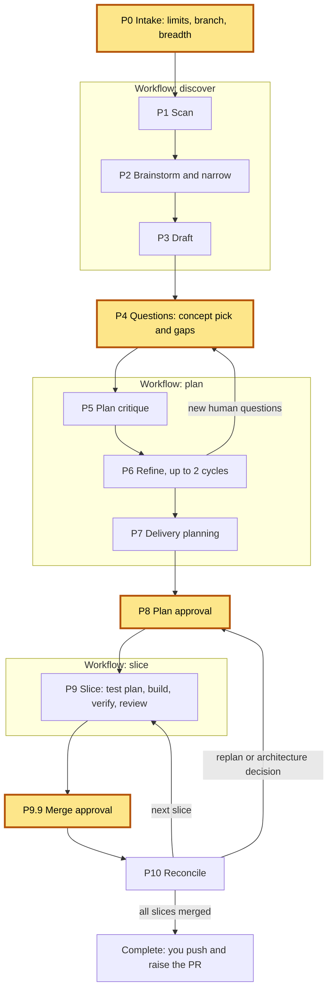

# Workflow: phases P0 to P10

Shipyard runs eleven phases. Four of them are stops where you decide. The rest run on their own.

Source: [04-phases.mmd](diagrams/04-phases.mmd) · rendered: [04-phases.svg](diagrams/04-phases.svg)

The yellow boxes are the four human stops.

| Phase | What runs | Run by | What you see |
|---|---|---|---|
| **P0 Intake** (stop) | Size check. One batched question: C-1 to C-9 and brainstorm breadth, each with a default. Branch check and creation. `state.json` written. `.ai/` kept off the work branches (`.git/info/exclude`) and snapshotted to the notes branch `<feature>-shipyard`. | Coordinator | One message to answer. A refusal if you name `main`, `master` or another protected branch. |
| P1 Scan | Discovery reads the repo: build, tests, structure, consumers, validation tiers. | `/shipyard:discover` | Status lines |
| P2 Brainstorm and narrow | Elephant/goldfish brainstorm, then synthesis and a gap list. Skipped at breadth 0. | `/shipyard:discover` | Status lines |
| P3 Draft | Discovery drafts the planning artifacts and the questions for you. | `/shipyard:discover` | Status lines |
| **P4 Questions** (stop) | Concept pick and the gaps that change the plan, in one turn, with recommendations. | Coordinator | Top concepts, disagreements, gaps |
| P5 Plan critique | Architect and simplicity reviewer always. Contract, integration, reliability and security reviewers when triggered. | `/shipyard:plan` | Status lines |
| P6 Refine | Fix the plan from the critique. At most 2 cycles. New questions for you end the workflow and go back to P4. | `/shipyard:plan` | Status lines, or new questions |
| P7 Delivery planning | Planner cuts slices with touch sets. Integration and architect check the order. One readiness goldfish per `SLICE.md`. | `/shipyard:plan` | Status lines |
| **P8 Plan approval** (stop) | `PLAN.HUMAN.md` shown in chat. Your explicit approval moves every slice to `APPROVED`. | Coordinator | One-screen plan brief |
| P9 Slice | Coordinator creates the slice branch. The workflow runs test plan, build, verify, review and fix rounds. Coordinator writes the evidence and brief. | Coordinator, then `/shipyard:slice` | Status lines; a question if a shared tier is needed; an escalation if it cannot converge |
| **P9.9 Merge** (stop) | You approve. Coordinator checks, merges with `--no-ff` into the feature branch, re-runs the tests. | Coordinator | `REVIEW.HUMAN.md` in chat, then a merge result |
| P10 Reconcile | Compare plan with reality. Architect REVALIDATE, planner RECONCILE. A replan or architecture decision goes back to P8. | Coordinator, direct calls | A short summary, or a new plan to approve |

P9 to P10 repeat for each slice. When all slices are merged, the status becomes `COMPLETE`. You push the feature
branch and raise the pull request. See [branching.md](branching.md).

## Project status values

`state.json` and `PROJECT.md` carry one of: `INTAKE`, `DISCOVERY`, `PLANNING`, `AWAITING_PLAN_APPROVAL`,
`IMPLEMENTING`, `COMPLETE`, `BLOCKED`. Status changes only between workflows, so `BRAINSTORMING` (P2) and
`DELIVERY_PLANNING` (P7) appear as phase-log labels rather than as the status line.

`BLOCKED` is set every time Shipyard stops safely. It always comes with a reason.

## Checkpoints

The coordinator updates `PROJECT.md` (status and a phase log row) and `state.json` at every phase change. That is
what makes a run resumable. See [getting-started.md](getting-started.md#resuming-after-an-interruption).
